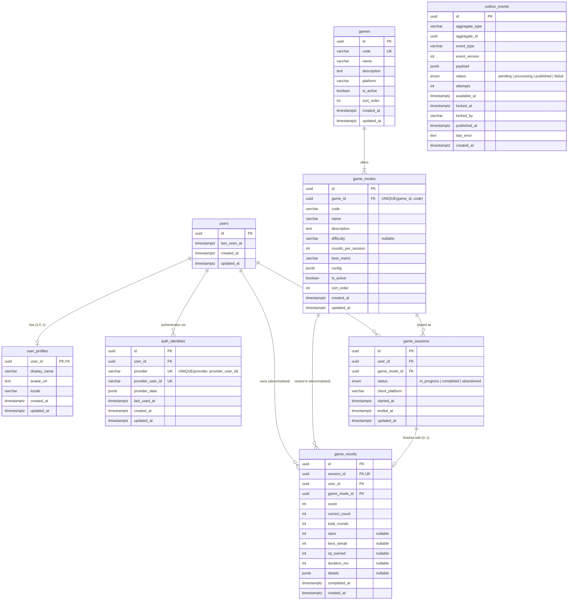

# Database

This is the PostgreSQL schema for Atlas Quest. It covers player accounts, external login identities, the game catalog, game sessions, final results, and a transactional outbox for future n8n integration.

| File | Purpose |
|---|---|
| [`prisma/schema.prisma`](../prisma/schema.prisma) | Prisma schema: the source of truth for tables, indexes and foreign keys |
| [`prisma/migrations/20261111000000_init`](../prisma/migrations/20261111000000_init/migration.sql) | Initial migration: the generated DDL, plus CHECK constraints and triggers |
| [`prisma/migrations/20261111000100_seed_game_catalog`](../prisma/migrations/20261111000100_seed_game_catalog/migration.sql) | Inserts the existing games and modes (reference data) |
| [`prisma/checks/schema_checks.sql`](../prisma/checks/schema_checks.sql) | Self-checking constraint tests. They run in one transaction and roll back. |
| [`prisma.config.js`](../prisma.config.js) | Prisma CLI config. Reads `DATABASE_URL`. |

Requirements: PostgreSQL 13 or later (for the built-in `gen_random_uuid()`), and Node.js `^20.19 || ^22.12 || >=24` for the Prisma 7 CLI.

The frontends don't use the database yet. Both games still keep their state in the browser, and their content (map, countries, capitals and question banks) stays embedded in the HTML.

---

## 1. Existing games and how they map to the catalog

I mapped the catalog from the shipped code: `index.html`, generated from `tools/telegram-template.html`, and `web/index.html`. **The Telegram and Web versions are different games.** Their modes, scoring and "best" metric all differ, so each one is a separate row in `games`.

### Telegram Mini App: `games.code = 'telegram_country_quiz'`

| | |
|---|---|
| Category | Countries only |
| Modes | Two difficulty levels: **Easy** (`easy`) and **Hard** (`hard`). These are the app's `level` values. |
| Round | 10 rounds that alternate **Find it** (tap the country on a zoomed map) and **Name it** (pick the highlighted country from 4 options), starting with Find it |
| Easy | The 75 largest countries. Wrong answers are drawn from the 4 nearest countries, with a wider zoom. |
| Hard | All quiz countries, with 6 nearest countries as distractors and a tighter zoom |
| Scoring | A correct answer scores `100 + min(50, (streak − 1) × 10)`. A wrong answer scores 0 and resets the streak. The maximum is **1350**. |
| "Best" | Highest **points** per level, stored in Telegram CloudStorage (`best_easy`, `best_hard`) or in localStorage |
| Other | Best streak, plus a result message based on correct answers (9+, 7+, 5+, otherwise) |

### Web Game: `games.code = 'web_expeditions'`

Five expeditions with **no difficulty levels**. The mode codes are the app's `MODES[].id` values.

| Mode code | Title | Rounds | Content per session | "Best" metric | Stamp at |
|---|---|---|---|---|---|
| `countries` | Countries | 10 | 5 shape + 3 flag + 2 clue questions | correct answers out of 10 | ≥ 8 correct |
| `capitals` | Capitals & big cities | 10 | 7 capital + 3 largest-city questions | correct answers out of 10 | ≥ 8 correct |
| `water` | Rivers, lakes & seas | 10 | 10 water questions | correct answers out of 10 | ≥ 8 correct |
| `peaks` | Mountains & relief | 10 | 10 relief questions | correct answers out of 10 | ≥ 8 correct |
| `chain` | Border journey | 3 journeys | 3 country-to-country routes of 3–4, 4–5 and 5–7 border crossings | stars out of 9 | ≥ 7 stars |

- **Quiz scoring** (the first four modes, all multiple choice with 4 options): a correct answer scores `100 + min(100, (streak − 1) × 20)`. The maximum is **1700**.
- **Border journey scoring:** each journey gets 3★ if moves ≤ the shortest route, 2★ if moves ≤ shortest + 2, 1★ if the player reaches the destination, and 0★ if they run out of moves. The move limit is `2 × shortest + 3`, and a step back counts as a move. Using more than one hint costs 1★. Each star is worth 150 points, for a maximum of **1350**.
- **Progression:** every expedition awards `XP = round(points / 10)`. Total XP sets the rank: Tourist 0, Day-tripper 150, Backpacker 400, Navigator 800, Pathfinder 1400, Cartographer 2300, Atlas Legend 3500. The game also stores passport stamps and bests in localStorage under the key `atlasQuest`.

### How the catalog captures this

- `game_modes.difficulty` is set only for the Telegram modes. The Web Game has no difficulty concept, so it stays `NULL` there. I didn't invent any levels.
- `game_modes.best_metric` records which result column the app uses as "best": `score` for Telegram, `correct_count` for the web quizzes, and `stars` for Border journey.
- `game_modes.rounds_per_session` is 10, or 3 for Border journey.
- `game_modes.config` (JSONB) documents each mode's rules: scoring formula, question mix, stamp threshold and legacy storage key. The frontend still enforces the rules, and this copy exists so a future API can validate submitted results.

---

## 2. ER diagram



`outbox_events` deliberately has no foreign keys. It refers to its source row by `aggregate_type` and `aggregate_id`, so an event can outlive the row it describes.

---

## 3. Tables

### `users`

A player. It holds **no provider-specific identifiers**: the Telegram ID, and any future email or OAuth subject, live only in `auth_identities`. That way one user can sign in through any number of providers, and nothing about a login is stored twice.

### `user_profiles`

Display data such as name, avatar and locale. It has a **1:1** relationship with `users` and shares its primary key (`user_id` is both the PK and an FK). I keep it separate so that auth and gameplay queries don't load presentation fields, and so profiles can change without touching `users`.

### `auth_identities`

This is the **single source of external authentication identities**. Each row links one external account to one user:

- `provider` is a lower-case code such as `telegram`. More providers can be added later without a migration.
- `provider_user_id` is the provider's stable ID, stored as text. Telegram user IDs are 64-bit integers, and other providers use strings.
- `provider_data` (JSONB) holds the latest provider fields, such as `username`, `language_code` and `is_premium`. Their shape differs per provider.
- `UNIQUE (provider, provider_user_id)` means an external account can belong to only one user.
- A user can hold many identities. That's how **the same player uses both the Telegram Mini App and the Web Game**: the Telegram identity and a future web login point to the same `users.id`. Logging in on the web with Telegram's login widget would reuse the same `telegram` identity.

### `games`

One row per distinct game. The rows are seeded from the existing code, as described in section 1. `code` is a stable string key, and `platform` names the frontend that ships the game (`telegram` or `web`). Setting `is_active` to false retires a game without deleting its history.

### `game_modes`

A playable variant of a game. Sessions and results point to a mode, not to a game. `code` is unique within its game. See section 1 for `difficulty`, `best_metric`, `rounds_per_session` and `config`.

### `game_sessions`

One play-through, by one user, of one game mode.

- `status` is `in_progress`, `completed` or `abandoned`. **`completed` is terminal** (enforced by a trigger).
- `ended_at` is set exactly when the status leaves `in_progress` (CHECK constraint).
- `client_platform` records where the session was played: `telegram` (inside the Telegram client) or `web` (a browser). The Telegram Mini App also opens in a normal browser, so you can't infer this from the game.

### `game_results`

The **final result** of a completed session.

- `UNIQUE (session_id)`: one result per session, at most.
- A trigger rejects the insert unless the session is `completed`, then copies the session's `ended_at` into `completed_at`.
- **Append-only history.** A new personal best is a new row, and earlier results are never overwritten. A trigger blocks any UPDATE except the `user_id` change made by an account merge.
- `user_id` and `game_mode_id` duplicate the session's values so that leaderboards and statistics need no join. The **composite foreign key** `(session_id, user_id, game_mode_id) → game_sessions(id, user_id, game_mode_id)` makes them match the session exactly.
- Columns map to what the games measure:

  | Column | Telegram | Web quizzes | Border journey |
  |---|---|---|---|
  | `score` | points | points | points (stars × 150) |
  | `correct_count` | correct rounds | correct answers | journeys with ≥ 2★ |
  | `total_rounds` | 10 | 10 | 3 |
  | `stars` | NULL | NULL | 0–9 |
  | `best_streak` | best streak | best streak | NULL |
  | `xp_earned` | NULL (no XP) | round(score/10) | round(score/10) |
  | `details` | optional per-round breakdown | optional question kinds and answers | per-journey route, moves, hints and stars |

  `details` (JSONB) holds the mode-specific breakdown and is never used for ranking.

### `outbox_events`

A **transactional outbox**. The API writes an event in the **same transaction** as the change it describes, for example `game_result.recorded` together with its `game_results` row. A change is never committed without its event, and an event is never emitted for a change that rolled back. A separate dispatcher delivers the events to n8n (see section 7).

- `id` is the event ID, which consumers use for **idempotency**. Delivery is at-least-once.
- `event_type` is a dotted name such as `game_result.recorded`. `event_version` versions the payload shape.
- `status`, `attempts`, `available_at` (retry back-off), `locked_at`/`locked_by` (dispatcher claim), `published_at` and `last_error` support retries and recovery after a crash.

---

## 4. Relationships

| From | To | Cardinality | FK | ON DELETE | Why |
|---|---|---|---|---|---|
| `user_profiles.user_id` | `users.id` | 1 : 0..1 | `user_profiles_user_id_fkey` | CASCADE | A profile has no meaning without its user |
| `auth_identities.user_id` | `users.id` | N : 1 | `auth_identities_user_id_fkey` | CASCADE | Deleting a user removes their logins |
| `game_modes.game_id` | `games.id` | N : 1 | `game_modes_game_id_fkey` | RESTRICT | Catalog rows are retired with `is_active`, never deleted from under history |
| `game_sessions.user_id` | `users.id` | N : 1 | `game_sessions_user_id_fkey` | CASCADE | A user's sessions go with the user (right to erasure) |
| `game_sessions.game_mode_id` | `game_modes.id` | N : 1 | `game_sessions_game_mode_id_fkey` | RESTRICT | A mode with history can't be deleted |
| `game_results.(session_id, user_id, game_mode_id)` | `game_sessions.(id, user_id, game_mode_id)` | 0..1 : 1 | `game_results_session_id_user_id_game_mode_id_fkey` | CASCADE (and ON UPDATE CASCADE) | A result belongs to exactly one session and must agree with its user and mode. ON UPDATE CASCADE moves results when sessions are reassigned in an account merge |
| `game_results.user_id` | `users.id` | N : 1 | `game_results_user_id_fkey` | CASCADE | Direct link used by leaderboards and statistics |
| `game_results.game_mode_id` | `game_modes.id` | N : 1 | `game_results_game_mode_id_fkey` | RESTRICT | Same reason as for sessions |

Every other foreign key keeps Prisma's default of ON UPDATE CASCADE. Primary keys are never updated in practice.

---

## 5. Indexes

| Index | Columns | Type | Serves |
|---|---|---|---|
| `auth_identities_provider_provider_user_id_key` | `(provider, provider_user_id)` | UNIQUE | Login lookup; one external account maps to one user |
| `auth_identities_user_id_idx` | `(user_id)` | btree | A user's identities; FK cascade |
| `games_code_key` | `(code)` | UNIQUE | Look up a game by code |
| `game_modes_game_id_code_key` | `(game_id, code)` | UNIQUE | Look up a mode by code; also covers the `game_id` FK |
| `game_sessions_user_id_started_at_idx` | `(user_id, started_at DESC)` | btree | A user's recent sessions; `user_id` FK |
| `game_sessions_game_mode_id_started_at_idx` | `(game_mode_id, started_at)` | btree | Per-mode activity; `game_mode_id` FK |
| `game_sessions_id_user_id_game_mode_id_key` | `(id, user_id, game_mode_id)` | UNIQUE | Target of the composite FK from `game_results` |
| `game_results_session_id_key` | `(session_id)` | UNIQUE | **One result per session** |
| `game_results_session_id_user_id_game_mode_id_key` | `(session_id, user_id, game_mode_id)` | UNIQUE | Prisma needs this for a 1:1 relation on a composite FK. It's redundant with `session_id` alone |
| `game_results_game_mode_id_score_completed_at_idx` | `(game_mode_id, score DESC, completed_at)` | btree | **Leaderboards**: top scores per mode, earliest achievement first on ties |
| `game_results_user_id_game_mode_id_completed_at_idx` | `(user_id, game_mode_id, completed_at DESC)` | btree | Player history and personal bests; `user_id` FK |
| `outbox_events_status_available_at_idx` | `(status, available_at)` | btree | Dispatcher polling for due `pending` events |
| `outbox_events_aggregate_type_aggregate_id_created_at_idx` | `(aggregate_type, aggregate_id, created_at)` | btree | Tracing all events for one entity |

Every foreign key has an index that starts with its columns, so cascades and RESTRICT checks don't need table scans. I verified with `EXPLAIN` that the leaderboard and history queries in section 6 use their indexes.

---

## 6. Constraints and triggers

Prisma can't express CHECK constraints or triggers, so they live in Part 2 of the init migration. Prisma's drift detection ignores them, which I verified: `migrate diff` against the migrated database is empty. Later migrations therefore won't drop them.

**Format checks.** Codes must match `^[a-z][a-z0-9_]*$`. This is a format rule rather than a fixed list, so new providers, games, modes and platforms need no migration. It applies to `auth_identities.provider`, `games.code`, `games.platform`, `game_modes.code`, `game_modes.difficulty`, `game_sessions.client_platform` and `outbox_events.aggregate_type`. `outbox_events.event_type` must be dotted, for example `game_result.recorded`.

**Value checks**

| Constraint | Rule |
|---|---|
| `user_profiles_display_name_not_blank` | Display name is NULL or not blank |
| `auth_identities_provider_user_id_not_blank` | Provider user ID is not blank |
| `*_is_object` | `provider_data`, `config`, `details` and `payload` must be JSON objects |
| `game_modes_rounds_per_session_positive` | > 0 |
| `game_modes_best_metric_valid` | One of `score`, `correct_count`, `stars` |
| `game_sessions_ended_at_matches_status` | `ended_at IS NULL` ⇔ `status = 'in_progress'` |
| `game_sessions_ended_after_started` | `ended_at ≥ started_at` |
| `game_results_score_non_negative` | `score ≥ 0` |
| `game_results_total_rounds_positive` | `total_rounds > 0` |
| `game_results_correct_count_range` | `0 ≤ correct_count ≤ total_rounds` |
| `game_results_stars_range` | `stars` is NULL or `0 ≤ stars ≤ 3 × total_rounds` |
| `game_results_best_streak_range` | `best_streak` is NULL or `0 ≤ best_streak ≤ correct_count` |
| `game_results_xp_earned_non_negative`, `game_results_duration_ms_non_negative` | ≥ 0 |
| `outbox_events_event_version_positive`, `outbox_events_attempts_non_negative` | `≥ 1`, `≥ 0` |
| `outbox_events_published_at_matches_status` | `published_at IS NOT NULL` ⇔ `status = 'published'` |

**Triggers**

| Trigger | When | Effect |
|---|---|---|
| `game_sessions_completed_is_final` | BEFORE UPDATE OF status on `game_sessions` | A `completed` session can't move to another status |
| `game_results_require_completed_session` | BEFORE INSERT on `game_results` | Rejects the result unless its session is `completed`, and sets `completed_at` to the session's `ended_at` |
| `game_results_immutable` | BEFORE UPDATE on `game_results` | Rejects any change except to `user_id`, which is reassigned during an account merge. DELETE still works, so user deletion cascades |

Violations raise SQLSTATE `23514` (check_violation), unique violations raise `23505`, and FK violations raise `23503`.

**Testing them.** [`prisma/checks/schema_checks.sql`](../prisma/checks/schema_checks.sql) asserts 23 behaviours: uniqueness, the identity rules, the session and result rules, history, merge, cascade, the outbox rules and the timestamp types. It runs in one transaction and rolls back. Use it on a local or staging database only:

```bash
psql "$DATABASE_URL" -v ON_ERROR_STOP=1 -f prisma/checks/schema_checks.sql
```

---

## 7. Main flows (for the future API)

**Telegram login.** Verify `initData` server-side with the bot token, then look up `auth_identities` where `provider = 'telegram'` and `provider_user_id = <user.id>`. If no row exists, create `users`, `user_profiles` and `auth_identities` in one transaction. On every login, refresh `provider_data` and `last_used_at`.

**Linking a second login.** An already authenticated user adds an `auth_identities` row with the new provider. The unique key blocks linking an account that already belongs to someone else.

**Account merge.** This is for when a player turns out to have two users. In one transaction: move the identities (`UPDATE auth_identities SET user_id = :keep`), then `UPDATE game_sessions SET user_id = :keep WHERE user_id = :drop`. Results follow through the composite FK's ON UPDATE CASCADE, and the immutability trigger allows that. Finally, delete the empty user.

**Recording a game.** Do this in one transaction:

1. `UPDATE game_sessions SET status = 'completed', ended_at = now() WHERE id = :s AND status = 'in_progress'`
2. `INSERT INTO game_results (...)`
3. `INSERT INTO outbox_events (aggregate_type, aggregate_id, event_type, payload) VALUES ('game_result', :result_id, 'game_result.recorded', {...})`

**Outbox dispatcher.** This is a worker, not part of this task. It claims due events with:

```sql
UPDATE outbox_events SET status = 'processing', locked_at = now(), locked_by = :worker, attempts = attempts + 1
WHERE id IN (
    SELECT id FROM outbox_events
    WHERE status = 'pending' AND available_at <= now()
    ORDER BY available_at
    LIMIT 50
    FOR UPDATE SKIP LOCKED)
RETURNING *;
```

After it POSTs an event to n8n, it sets either `status = 'published', published_at = now()`, or `status = 'pending', available_at = now() + backoff, last_error = …`. After N attempts it sets `status = 'failed'`. Rows left in `processing` with an old `locked_at` came from a crashed worker and can go back to `pending`. Send `id` as an idempotency key so n8n can drop duplicates.

---

## 8. Leaderboards and statistics (queries, no extra tables)

The initial migration has **no leaderboard table and no `user_statistics` table**. Everything is calculated from `game_results`, and you can wrap any of these queries in a view when the API needs it.

**Leaderboard per mode** (each player's best result, ranked by points, with ties going to whoever got there first). It uses `game_results_game_mode_id_score_completed_at_idx`:

```sql
SELECT rank() OVER (ORDER BY best.score DESC, best.completed_at) AS position,
       coalesce(p.display_name, 'Explorer') AS player,
       best.score, best.correct_count, best.completed_at
FROM (
    SELECT DISTINCT ON (r.user_id) r.user_id, r.score, r.correct_count, r.completed_at
    FROM game_results r
    WHERE r.game_mode_id = $1
    --  AND r.completed_at >= now() - interval '7 days'   -- weekly board
    ORDER BY r.user_id, r.score DESC, r.completed_at
) best
LEFT JOIN user_profiles p ON p.user_id = best.user_id
ORDER BY position
LIMIT 100;
```

Leaderboards rank by **points** in every mode. For Telegram and Border journey this matches the in-game "best", since Border journey points are stars × 150. For the web quizzes, the app's personal "best" is correct answers, while points also reward streaks. The personal-best query below follows `best_metric`, so it matches the app exactly.

**Personal bests per mode**, matching what each frontend shows:

```sql
SELECT g.code AS game, gm.code AS mode, gm.best_metric,
       CASE gm.best_metric WHEN 'score'         THEN max(r.score)
                           WHEN 'correct_count' THEN max(r.correct_count)
                           WHEN 'stars'         THEN max(r.stars) END AS best,
       count(*) AS plays,
       max(r.completed_at) AS last_played
FROM game_results r
JOIN game_modes gm ON gm.id = r.game_mode_id
JOIN games g ON g.id = gm.game_id
WHERE r.user_id = $1
GROUP BY g.code, gm.code, gm.best_metric, gm.sort_order
ORDER BY g.code, gm.sort_order;
```

**Player totals.** Web XP drives the rank ladder:

```sql
SELECT count(*)                       AS games_completed,
       coalesce(sum(xp_earned), 0)    AS total_xp,
       sum(correct_count)             AS total_correct,
       max(completed_at)              AS last_played
FROM game_results
WHERE user_id = $1;
```

**Passport stamps (Web).** A stamp is earned when any result reaches the mode's `config->'stampThreshold'`:

```sql
SELECT DISTINCT gm.code
FROM game_results r JOIN game_modes gm ON gm.id = r.game_mode_id
WHERE r.user_id = $1
  AND gm.config ? 'stampThreshold'
  AND CASE gm.config->'stampThreshold'->>'metric'
        WHEN 'correct_count' THEN r.correct_count
        WHEN 'stars'         THEN r.stars END
      >= (gm.config->'stampThreshold'->>'min')::int;
```

---

## 9. Future tables (documented, not implemented)

These tables aren't in the migration. Add each one in its own migration when the feature is built.

| Table | Purpose | Sketch |
|---|---|---|
| `achievements` | Catalog of achievements, such as the Web Game's passport stamps and streak badges | `id uuid PK`, `code varchar UNIQUE`, `name`, `description`, `game_mode_id uuid NULL FK → game_modes` (NULL means global), `criteria jsonb` (for example `{"metric":"correct_count","min":8}`), `is_active`, timestamps |
| `user_achievements` | Achievements a user has earned | `user_id FK → users ON DELETE CASCADE`, `achievement_id FK → achievements ON DELETE RESTRICT`, `game_result_id uuid NULL FK → game_results` (the result that earned it), `earned_at timestamptz`; `PRIMARY KEY (user_id, achievement_id)` |
| `game_answers` | Per-round answers, for analytics and replay | `id uuid PK`, `session_id FK → game_sessions ON DELETE CASCADE`, `round_index int`, `question_kind varchar` (shape, flag, clue, capital, big_city, water, relief, find, name, journey_step), `prompt_ref varchar` (content key, for example the country name), `given_answer varchar`, `correct_answer varchar`, `is_correct bool`, `points int`, `answered_at timestamptz`; `UNIQUE (session_id, round_index)` |
| `user_statistics` | Pre-aggregated per-user, per-mode totals, if the queries in section 8 become too slow | `user_id`, `game_mode_id`, `plays`, `best_score`, `best_correct`, `best_stars`, `total_xp`, `last_played_at`; `PRIMARY KEY (user_id, game_mode_id)`. Maintained from `game_results` by the API or a trigger, and always rebuildable from it |

---

## 10. Out of scope here

- **No game content in the database.** The map, countries, capitals, flags and question banks stay embedded in `index.html` and `web/index.html`, unchanged.
- **No leaderboard or statistics tables.** See section 8.
- **No frontend or API changes.** The games still use local storage, and connecting them to the API is a separate task. The `legacyBestStorageKey` values in `config` are there to help with a later import of local bests.
- **No Prisma Client yet.** The schema declares a `prisma-client` generator (output `src/generated/prisma`, which is gitignored). Generating it will need `@prisma/client` and a driver adapter such as `@prisma/adapter-pg` once the API starts using the database.

---

## 11. Applying migrations

**Nothing applies migrations automatically.** `deploy.yml` doesn't run Prisma, and the two migrations only create objects and insert catalog rows. They never drop, truncate or rewrite anything.

```bash
cd backend
npm install                  # includes the Prisma CLI (dev dependency)
npm run db:validate          # schema is valid
npm run db:status            # which migrations are pending on DATABASE_URL

# Local or staging database:
npm run db:migrate:deploy    # applies pending migrations, never resets the database
psql "$DATABASE_URL" -v ON_ERROR_STOP=1 -f prisma/checks/schema_checks.sql
```

For production, an administrator should run `npm run db:migrate:deploy` manually with production `DATABASE_URL`, after taking a backup (`pg_dump`). Don't use `prisma migrate dev`, `prisma migrate reset` or `prisma db push` against shared databases, because they can reset or drop data.

To change the schema later, edit `schema.prisma`, then create a new migration with `prisma migrate dev --create-only` against a **local** database. Review the SQL and commit it. Never edit a migration that has already been applied.
