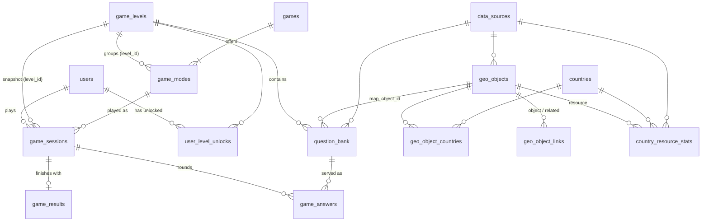

# Database schema

PostgreSQL 13+ (uses the built-in `gen_random_uuid()`). Prisma owns the schema (`backend/prisma/schema.prisma`) and migrations (`backend/prisma/migrations/`); the API queries with plain SQL. The v1 core (identity, catalog, sessions, results, outbox) is documented in depth, with every constraint, index and trigger, in [backend/docs/database.md](../backend/docs/database.md). This document covers the whole model and everything added in v2.0.0.

## Migrations

| Migration | Release | What it does |
|---|---|---|
| `20261111000000_init` | v1.4 | Identity, catalog, sessions, results, outbox; CHECKs and triggers |
| `20261111000100_seed_game_catalog` | v1.4 | Games `telegram_country_quiz`, `web_expeditions` and their 7 modes |
| `20261117000000_v2_levels_question_engine` | v2.0.0 | **Additive:** 10 new tables, nullable columns on `game_modes`, `game_sessions`, `game_results`; CHECKs; triggers `game_answers_answer_once`, `game_sessions_scoring_is_final` |
| `20261117000100_seed_levels` | v2.0.0 | 5 `game_levels`; attaches the Telegram easy/hard modes to Level 1 (catalog rows only); game `explorer_levels` with modes `hydro`, `earth`, `resources`, `master` |
| `20261118000000_v2_1_score_progression` | v2.1.0 | **Additive for player data:** `user_profiles.level` (NOT NULL DEFAULT 1, CHECK ≥ 1, trigger `user_profiles_level_never_decreases`), `game_results.scoring_version` (nullable SMALLINT); catalog: recalibrated `game_modes.config.scoring` (Level 1 Easy/Hard, levels 2–5) and `total_score` unlock rules on levels 2–5 |

Questions and geographic knowledge are **not** in migrations; they are imported from `backend/content/` ([GEOGRAPHIC_DATA_SOURCES.md](GEOGRAPHIC_DATA_SOURCES.md)).

### Why the v2 migration is safe for production data
- Only `CREATE TABLE`, `CREATE INDEX`, `ADD COLUMN` (all nullable, no default, so no table rewrite) and `ADD CONSTRAINT`. No `UPDATE` or `DELETE` of player data.
- New CHECKs on existing tables only constrain the new columns (`... IS NULL OR ...`), so every existing row satisfies them.
- The seed migration updates only `game_modes.level_id` of the two Telegram catalog rows, and only where it is NULL.
- Verified by the test "upgrade from v1 keeps history exactly": v1 migrations plus a v1 result, then the v2 migrations; the result row is byte-identical, and the player has Level 1 completed and Level 2 open.

### Why the v2.1 migration is safe for production data
- Two `ADD COLUMN`s. `user_profiles.level` is NOT NULL with a **constant** default, which PostgreSQL 11+ adds without rewriting the table. This deliberately departs from the "nullable column" convention, because every player has a level. `game_results.scoring_version` is nullable.
- No player row is updated. `game_results` keeps its exact values, and `scoring_version` stays NULL on every existing row (meaning the original scale, normalized ÷10 on read only).
- Catalog `UPDATE`s touch only rows that still hold the seeded v2.0.0 values (`correctBase = 100`, `streakBonusPerStep = 10`, `level_completed` rules), so a manual tuning is never overwritten.
- Verified by "upgrade from v2.0 keeps unlocks and history": v2.0 migrations, a v2.0 result, a sticky unlock and an open session, then the v2.1 migration. Results are byte-identical, Level 2 stays unlocked, and the open session completes on its original rules.

### Rollback of `20261118000000`
Roll back the code to v2.0.0 first; v2.0.0 ignores both new columns. The catalog rules must go back too, because v2.0.0 code doesn't know `pointScale` or `total_score`. Run after `pg_dump`:
```sql
BEGIN;
UPDATE game_modes gm SET config = jsonb_set(config, '{scoring}', '{"correctBase":100,"streakBonusPerStep":10,"streakBonusCap":50,"wrong":0,"maxScore":1350}')
  FROM games g WHERE g.id = gm.game_id AND g.code = 'telegram_country_quiz' AND gm.code IN ('easy','hard');
UPDATE game_modes gm SET config = jsonb_set(config, '{scoring}', (config->'scoring') - 'pointScale' || '{"streakBonusPerStep":10,"streakBonusCap":50}')
  FROM games g WHERE g.id = gm.game_id AND g.code = 'explorer_levels';
UPDATE game_levels SET unlock_rule = jsonb_build_object('type','level_completed','level', number - 1) WHERE number BETWEEN 2 AND 5;
-- Optional; the columns are harmless to v2.0.0:
-- DROP TRIGGER user_profiles_level_never_decreases ON user_profiles; DROP FUNCTION user_profiles_level_never_decreases();
-- ALTER TABLE user_profiles DROP COLUMN level; ALTER TABLE game_results DROP COLUMN scoring_version;
-- DELETE FROM _prisma_migrations WHERE migration_name = '20261118000000_v2_1_score_progression';
COMMIT;
```
Results recorded on the v2.1 scale stay in `game_results` with their small scores. v2.0.0 code would count them as they are (×1 of the old scale).

### Rollback of `20261117000000` / `20261117000100`
The application code of v2 needs these tables, so roll back the code first (deploy the v1.4.8 commit). The v1 code ignores the new columns and tables, so **leaving the schema in place is the recommended rollback**. Only if the schema itself must go (after `pg_dump`!). Tested on PGlite on 2026-11-17:
```sql
BEGIN;
DROP TRIGGER game_sessions_scoring_is_final ON game_sessions; DROP FUNCTION game_sessions_scoring_is_final();
DROP TRIGGER game_answers_answer_once ON game_answers; DROP FUNCTION game_answers_answer_once();
DROP TABLE game_answers, user_level_unlocks, country_resource_stats, geo_object_links, geo_object_countries,
           question_bank, geo_objects, countries, data_sources CASCADE;
ALTER TABLE game_results DROP COLUMN base_score, DROP COLUMN score_multiplier;
ALTER TABLE game_sessions DROP COLUMN level_id, DROP COLUMN score_multiplier, DROP COLUMN scoring_rules, DROP COLUMN rounds_planned;
ALTER TABLE game_modes DROP COLUMN level_id;
DELETE FROM game_modes WHERE game_id = (SELECT id FROM games WHERE code = 'explorer_levels')
  AND NOT EXISTS (SELECT 1 FROM game_sessions s WHERE s.game_mode_id = game_modes.id);
DROP TABLE game_levels;
DELETE FROM _prisma_migrations WHERE migration_name LIKE '20261117%';
COMMIT;
```
This deletes v2 gameplay history (levels 2–5 sessions and answers). Results of levels 2–5 stay in `game_results` linked to their modes; the `DELETE FROM game_modes` keeps modes that have sessions.

## ER diagram (v2 additions and their links to v1)



## New tables (v2.0.0)

### `game_levels` (reference data, owner: product)
`number` 1–99 (UK), `code` (UK, e.g. `hydro`), `name`, `short_description`, `description`, `icon`, `score_multiplier numeric(5,2)` (>0, ≤100), `categories jsonb` (`[{code,name}]`), `unlock_rule jsonb`, `completion_rule jsonb`, `session_config jsonb` (`{defaultRounds, allowedRounds}`), `is_active`, `sort_order`. Rules: [SCORING_AND_PROGRESSION.md](SCORING_AND_PROGRESSION.md).

### `user_level_unlocks` (player data)
PK `(user_id, level_id)`. `source` ∈ `rule | admin | achievement`, `granted_by`, `note`, `unlocked_at`. Written the first time a rule is met (sticky unlocks) or by `npm run admin:unlock`. User delete cascades.

### `game_answers` (player data, append-once)
One row per served round: `session_id` (cascade), `round_index` (UK with session), `question_id` (RESTRICT), `question_version`, `correct_answers` (snapshot when served), `score_multiplier` (snapshot), `presented_at`; filled once on answer: `answered_at`, `answer jsonb`, `fraction numeric(5,4)` 0..1, `is_correct`, `base_points`, `streak_bonus`, `points`, `response_ms`.
- CHECK `game_answers_answered_consistently`: an answered round has answer, fraction, correctness and points; an open one has none.
- Trigger `game_answers_answer_once`: an answered round can never change; a round can only be answered while its session is `in_progress`; what was served (question, version, correct answers, multiplier) never changes.

### `question_bank` (content)
Spec fields: `id, code (UK), level_id, category, subcategory, question_type, answer_mode, difficulty 1–3, question_text, question_description, map_object_type, map_object_id, map jsonb, options jsonb, correct_answers jsonb, fact_ref jsonb, explanation, base_points (0–10000, default 100), time_limit_sec, data_source_id, data_year, language, is_active, verification_status, origin, reviewed_by, reviewed_at, review_note, version, content_hash`.
- `verification_status` ∈ `draft | in_review | verified | rejected`; `origin` ∈ `curated | ai_generated | imported`.
- CHECK `question_bank_verified_is_reviewed`: verified ⇒ `reviewed_by` and `reviewed_at` set.
- Only `verified AND is_active` rows are ever served (index `(level_id, verification_status, is_active)`).

### Knowledge base (content; source of truth for facts)
| Table | Key | Purpose |
|---|---|---|
| `data_sources` | `code` UK | name, url, **license**, attribution, retrieved_at |
| `countries` | `code` UK, `name` UK | map name; `is_on_map` false for countries too small for the 1:110m map (Monaco, Liechtenstein, Singapore) |
| `geo_objects` | `code` UK | `object_type` (river, lake, sea, ocean, strait, canal, waterfall, mountain_range, peak, volcano, mountain_pass, canyon, valley, tunnel, mineral_resource, deposit, desert, natural_region, forest), `lat/lon numeric(9,6)`, `geometry_layer/key/feature_id` (layer file reference), `bbox`, `wikidata_id`, `properties jsonb`, source, year, `verification_status`, notes |
| `geo_object_countries` | PK `(object_id, country_id, relation)` | e.g. `flows_through`, `basin`, `source_country`, `crosses`, `shared_by`, `located_in`, `borders`, `connects_countries`, `covers`, `largest_share` |
| `geo_object_links` | PK `(object_id, related_object_id, relation)` | e.g. `mouth`, `connects`, `part_of_range`, `carved_by`, `on_river`, `produces` |
| `country_resource_stats` | UK `(country, resource, metric, data_year, source)` | `metric` ∈ **`mine_production | reserves | identified_resources`** (CHECK), `value`, `unit`, `data_year`, `is_estimate`, `rank` |

Every knowledge row has a `verification_status`. The importer never deletes: facts removed from the content files are marked `rejected` with a dated note.

## Columns added to v1 tables

| Table | Column | Meaning |
|---|---|---|
| `game_modes` | `level_id` | the level this mode belongs to (NULL for the Web Game) |
| `game_sessions` | `level_id`, `score_multiplier`, `scoring_rules jsonb`, `rounds_planned` | scoring snapshot taken at start; immutable afterwards (trigger `game_sessions_scoring_is_final`); NULL on pre-v2 sessions |
| `game_results` | `base_score`, `score_multiplier` | `score = round(base_score × score_multiplier)`; both NULL on pre-v2 results (CHECK: both or neither) |
| `game_results` | `scoring_version` (v2.1, nullable) | scale of `score`: NULL/1 = original (counted ÷10 in totals and bests), 2 = v2.1 scale. Copied from `game_sessions.scoring_rules.version` |
| `user_profiles` | `level` (v2.1, NOT NULL DEFAULT 1) | highest N with levels 1..N unlocked; raised by the backend, never lowered (trigger). Total score is **not** stored; it is `SUM` over `game_results` |

## Indexes (v2)
`game_levels_number_key`, `game_levels_code_key`; `game_modes_level_id_idx`; `game_sessions_level_id_idx`; `game_answers_session_id_round_index_key` (**one answer per round**), `game_answers_question_id_idx`; `question_bank_code_key`, `question_bank_level_id_verification_status_is_active_idx`, `question_bank_map_object_id_idx`, `question_bank_data_source_id_idx`; `user_level_unlocks_level_id_idx`; `geo_objects_code_key`, `geo_objects_object_type_idx`, `geo_objects_data_source_id_idx`; `geo_object_countries_country_id_idx`, `…_data_source_id_idx`; `geo_object_links_related_object_id_idx`, `…_data_source_id_idx`; `countries_code_key`, `countries_name_key`; `country_resource_stats_…_key` (natural key), `country_resource_stats_resource_object_id_metric_data_year_idx`, `…_data_source_id_idx`; `data_sources_code_key`. Every foreign key has an index starting with its columns.

## Data ownership

| Data | Owner | Written by |
|---|---|---|
| users, profiles, identities, sessions, results, answers, unlocks | the player | API only |
| games, game_modes, game_levels | product | migrations; tuning by an admin with SQL (document it in the changelog) |
| data_sources, countries, geo_*, country_resource_stats, curated questions | content editors | `npm run content:import` from reviewed files |
| AI question drafts | n8n | `POST /api/internal/question-drafts` (`in_review` only) |
| outbox_events | integration | API, in the same transaction as the change |

## Geographic data model in short

Facts are explicit, sourced relations, not computed geometry: "the Danube flows through Hungary" is a `geo_object_countries` row with its source. Points carry lat/lon for map markers. Lines and areas are referenced by feature id in a static layer file. Questions reference facts through `fact_ref`, and the content validator derives their correct answers from these tables, so a question can't contradict the knowledge base.

## Decisions
- **2026-11-17: one unified `geo_objects` table instead of one table per object kind** (`rivers`, `lakes`, `straits`, ...). Every kind shares the same columns (name, location, source, verification), and kind-specific facts fit in `properties` and in typed relations. New kinds need no migration. Revisit if a kind needs many queried, typed columns.
- **2026-11-17: `user_level_unlocks` stores unlocks, not progress.** Progress (plays, best, completion, mastery) is always derived from immutable `game_results` and `game_answers`, so it can't drift. Unlocks are stored because they must survive rule changes.
- **2026-11-18: `user_profiles.level` added; total score stays derived.** *Previous:* no stored level; unlocks only in `user_level_unlocks`. *New:* `user_profiles.level` stores the highest contiguous unlocked level (owner request), kept in sync in the transaction that records a result, and never lowered. The lifetime score is still computed (`SUM` over `game_results`, older scale ÷10) and not stored, and there is still no separate scoring table. *Reason:* a persistent, cross-device level that the UI can show cheaply. *Migration:* `20261118000000`; existing profiles start at 1 and catch up from their unlocks at the next login.
- **2026-11-18: `game_results.scoring_version` instead of rescaling history.** *Previous:* one scale; `score` was comparable across all results. *New:* v2.1.0 divided points by 10. Old rows keep their score, and readers normalize with `progressScoreSql()`. *Reason:* `game_results` is append-only and must never be rewritten. *Migration:* nullable column, NULL on all existing rows.
