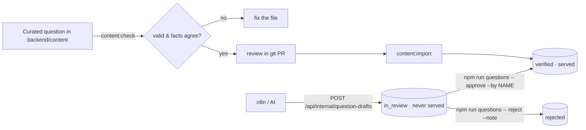

# Question engine

One reusable engine serves, validates and scores the questions of every engine level (2–5). Level-specific behaviour comes from **data** (the question's type, answer mode, map presentation and fact reference), never from per-level code.

Code: `backend/src/engine/` (pure), `backend/src/services/sessions.js` (I/O), `backend/src/content/` (authoring pipeline).

## Question data structure

Database: `question_bank` ([DATABASE_SCHEMA.md](DATABASE_SCHEMA.md)). Authoring: `backend/content/questions/level-<n>-<code>.json`:

```json
{
  "level": "hydro",
  "status": "verified",
  "reviewedBy": "seed:v2.0.0",
  "reviewNote": "Facts checked on 2026-11-17 against ...",
  "questions": [
    {
      "code": "hydro.danube.countries",
      "category": "rivers",
      "type": "GEO_RELATIONSHIP",
      "difficulty": 2,
      "text": "Select every country the Danube flows through or along.",
      "description": "Tap the countries on the map, then press Check.",
      "object": "danube",
      "map": { "focus": { "area": [36, 3, 54, 36] } },
      "fact": { "object": "danube", "countries": "flows_through" },
      "explanation": "The Danube starts at Donaueschingen in Germany and runs about 2,850 km ...",
      "source": "wikipedia"
    }
  ]
}
```

| Field | Required | Meaning |
|---|---|---|
| `code` | yes | stable id `[a-z0-9][a-z0-9_.-]*`; AI drafts start with `ai.` |
| `category` / `subcategory` | yes / no | codes from the level's `categories` (checked on import) |
| `type` | yes | one of the 9 types below |
| `answerMode` | no | overrides the type's default mode (must be allowed) |
| `difficulty` | yes | 1 easy … 3 hard |
| `text`, `description` | yes / no | prompt and optional hint |
| `object` | no | `geo_objects.code` the question is about (`map_object_id`) |
| `map` | no | `focus` (`{area:[minLat,minLon,maxLat,maxLon]}` / `{countries:[...]}` / `{object:true, padding:deg}`), `showObject` (draw the object before answering), `layers` (`rivers`, `lakes`), `highlightCountries` |
| `options` | per mode | labels (`options`), or `{left:[...], right:[...]}` (`pairs`); TRUE_FALSE defaults to True/False |
| `correct` | if no `fact` | labels / country names / `[[left, right], ...]` |
| `fact` | recommended | reference to verified knowledge; answers are **derived** from it |
| `explanation` | yes | shown after answering |
| `source`, `year` | yes / for statistics | `data_sources.code`, data year |
| `basePoints`, `timeLimitSec`, `language`, `active`, `status`, `origin` | no | defaults 100, null, `en`, true, file status, `curated` |

### Fact references (`fact`)

| Form | Resolves to |
|---|---|
| `{"object":"mekong","countries":"flows_through"}` | the object's verified countries for that relation |
| `{"object":"bosporus","links":"connects"}` | names of the verified linked objects |
| `{"intersect":[ref, ref, ...]}` | the intersection of several sets (e.g. Andes ∩ Amazon) |
| `{"stat":{"resource":"copper","metric":"mine_production","year":2024,"rank":1}}` | the country with that rank; `ranks:[1,2,3]` for several |
| `{"pairs":{"objects":[...],"links":"mouth"}}` / `"countries":"source_country"` | `[objectName, relatedName]` pairs (exactly one each) |
| `{"pairs":{...,"match":"any"}}` | each given `correct` pair must be *one of* the verified relations |
| `{"pairs":{"stats":[{label, resource, metric, year, rank}, ...]}}` | `[label, country]` pairs |

If both `correct` and `fact` are given, they must agree; otherwise validation fails with "contradicts verified knowledge". Only `verified` objects, relations and statistics can be used.

## Supported question types

| Type | Default mode | Allowed modes | Multi | Example |
|---|---|---|---|---|
| SINGLE_CHOICE | options | options | no | "Which river carved the Grand Canyon?" |
| MULTIPLE_CHOICE | options | options | yes | "Select the three countries that mined the most copper in 2024." |
| TRUE_FALSE | options | options | no | "Lake Baikal is the deepest lake in the world." |
| MAP_IDENTIFICATION | map_single | map_single | no | "Tap the country where Mount Kilimanjaro stands." |
| COUNTRY_IDENTIFICATION | options | options, map_single | no | highlighted country → name (no seed content yet) |
| OBJECT_IDENTIFICATION | options | options | no | highlighted river → "Danube / Rhine / Volga / Dnieper" |
| MATCHING | pairs | pairs | yes | rivers → mouths |
| GEO_RELATIONSHIP | map_multi | map_multi, options | yes | "Select every country the Mekong flows through." |
| RESOURCE_IDENTIFICATION | map_single | map_single, options | no | "Which country mined the most cobalt in 2024? Tap it." / marked mine → mineral |

Adding a type: add it to `QUESTION_TYPES` (`engine/question-types.js`) and to the `question_bank_question_type_valid` CHECK (new migration), add rendering in the template if it needs a new answer mode, and add tests.

## Question generation and selection

`startSession` (levels 2–5):
1. Candidates: `verification_status = 'verified' AND is_active AND difficulty BETWEEN mode.config.difficulty.min AND max` for the level.
2. **Avoid recent repeats:** the questions of the player's last `recentQuestionWindow` (30) rounds in that level are put last; unseen questions are shuffled first. A session never contains the same question twice.
3. Take `rounds` questions (default 10; `allowedRounds` from `game_levels.session_config`). If fewer exist, all are served and `rounds_planned` records the real number.
4. One `game_answers` row per round, with **snapshots** of question version, correct answers and multiplier.
5. The client gets `publicQuestion()`: text, type, mode, options (shuffled; ids stable), map focus/layers/highlights, and the object only if `showObject`. Never correct answers, explanations or fact references.

## Answer validation (deterministic)

`POST /sessions/:id/answers {round, answer}` → `evaluateAnswer()`. No AI, no network.

| Mode | Answer body | Correct when |
|---|---|---|
| options | `{"optionIds":["o2"]}` | single: the one correct id; multi: all correct ids and nothing else |
| map_single | `{"countries":["Chile"]}` | the tapped country is a correct answer |
| map_multi | `{"countries":["Peru","Colombia"]}` | exactly the correct set |
| pairs | `{"pairs":[{"left":"l1","right":"r2"}]}` | every left item paired correctly |

Shape errors → `422 invalid_answer`. Rounds must be answered **in order** (`409 round_out_of_order`) and **once** (`409 round_already_answered`; also enforced by trigger `game_answers_answer_once`). Scoring always uses the correct answers that were served (snapshot), even if the question has been edited since.

## Partial scoring

- Multi-select (`MULTIPLE_CHOICE`, `GEO_RELATIONSHIP`): `fraction = max(0, (correct picks − wrong picks) / number of correct answers)`. Selecting everything therefore scores 0.
- Matching: `fraction = correctly matched pairs / pairs`.
- Points: `round(basePoints × fraction)`. Only fully correct answers (`fraction = 1`) get the streak bonus and keep the streak. Details: [SCORING_AND_PROGRESSION.md](SCORING_AND_PROGRESSION.md).

## Difficulty handling

Each question has a difficulty of 1–3. A mode's `config.difficulty` range filters what can be served (all levels currently use 1–3). Planned: per-player adaptive ranges from `/me/stats` accuracy.

## Duplicate prevention

| Duplicate | Prevented by |
|---|---|
| same question twice in a session | selection takes distinct ids |
| recently seen questions | recent-window ordering |
| answering a round twice / double scoring | `UNIQUE(session_id, round_index)` + `UPDATE ... WHERE answered_at IS NULL` + trigger |
| completing a session twice | session row lock + status check (`409 session_closed`), `UNIQUE(game_results.session_id)` |
| two curated questions with one code | `question_bank.code` UNIQUE + validator |

## Verification workflow



- Curated files marked `verified` must name `reviewedBy`; the database requires `reviewed_by` and `reviewed_at` for every verified row.
- AI drafts are validated by the same code as curated content. With a `fact` reference, their answers come from the knowledge base; without one, the review note says a reviewer must check them against a source.
- Editing a curated question and re-importing bumps `version`; played rounds keep their snapshot.

## Realistic examples

A served question (`POST /api/sessions` → `questions[i]`):
```json
{
  "round": 2, "type": "GEO_RELATIONSHIP", "answerMode": "map_multi", "multi": true,
  "category": "rivers", "difficulty": 2,
  "text": "Select every country the Mekong flows through.", "description": null,
  "basePoints": 100, "timeLimitSec": null, "options": null,
  "map": { "focus": { "bbox": [736.1, 144.4, 847.2, 250] }, "layers": [], "highlightCountries": [], "object": null },
  "dataYear": null
}
```

The answer result (`POST /api/sessions/:id/answers`):
```json
{
  "round": 0, "isCorrect": true, "fraction": 1, "basePoints": 100, "streakBonus": 0,
  "multiplier": 2, "points": 200, "streak": 1, "score": 200, "answeredRounds": 1, "totalRounds": 10,
  "responseMs": 5400,
  "correct": { "optionIds": ["o1", "o2"], "labels": ["Black Sea", "Sea of Marmara"] },
  "offMapAnswers": [],
  "explanation": "The Bosporus connects the Black Sea to the Sea of Marmara and forms part of the boundary between Europe and Asia.",
  "object": { "name": "Bosporus", "type": "strait", "shape": { "kind": "point", "x": 580.8, "y": 135.8 } },
  "source": { "name": "Wikipedia (English)", "url": "https://en.wikipedia.org/", "year": null }
}
```

A stored matching question (`question_bank.options` / `correct_answers`):
```json
{ "left": [{"id":"l1","label":"Mine production (2024)"},{"id":"l2","label":"Reserves"},{"id":"l3","label":"Identified resources"}],
  "right": [{"id":"r1","label":"Australia"},{"id":"r2","label":"Chile"},{"id":"r3","label":"Argentina"},{"id":"r4","label":"China"}] }
[{"left":"l1","right":"r1"},{"left":"l2","right":"r2"},{"left":"l3","right":"r3"}]
```

## Multilingual support (prepared)

`question_bank.language` (BCP 47) exists; questions are English. Plan: one row per language per question code (e.g. `hydro.danube.countries@ka`), sharing the same `fact` reference, so answers stay identical across languages.
