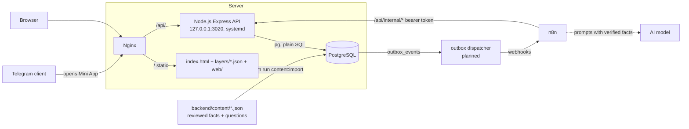
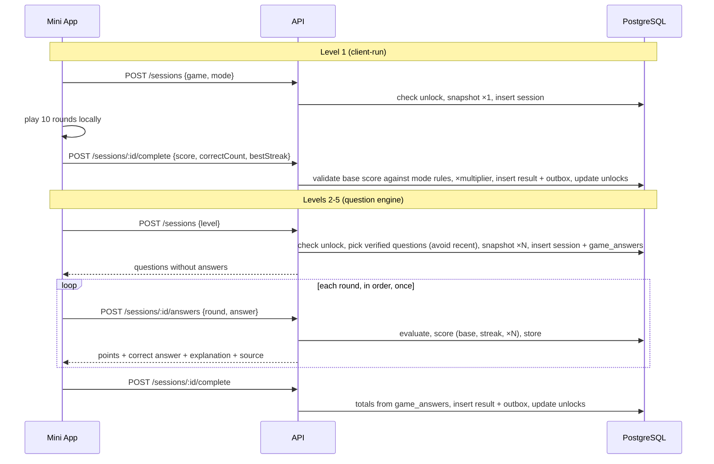

# System architecture

## Overview



## Frontend

| Part | Where | Notes |
|---|---|---|
| Telegram Mini App | `index.html` (generated) | Single file, no framework, no build step at runtime. Source: `tools/telegram-template.html`; build: `cd tools && npm run build-app`, which embeds the country map (Natural Earth 1:110m via `world-atlas`) and writes `backend/content/map-countries.json`. |
| Map layers | `layers/rivers.json`, `layers/lakes.json` | Natural Earth 1:50m, projected to map coordinates by `tools/build-layers.js`. Loaded with `fetch` only when a question or the player needs them. They contain no names, so a highlighted river can't be looked up in the file. |
| Web Game | `web/index.html` | The older five-expedition browser game; local storage only, unchanged in v2. |

Screens in `index.html`: `sAuth` (sign-in gate), `sHome` (Level Selection), `sStart` (Level 1 intro, the original start screen), `sIntro` (levels 2–5 intro), `sGame` (shared game screen), `sResult`.

### Map rendering

An SVG with an equirectangular projection, 1000 units wide: `x = (lon + 180) × 1000/360`, `y = (90 − lat) × 1000/360`. The same formula is used by `tools/build-map.js`, `tools/build-layers.js` and `backend/src/engine/geo.js`, so server-side focus boxes and markers line up with the client map. `makeMap()` provides `view/fit/world`, `paint/unpaint/label/labelAt/marker`, `showLayer/feature` and `setInteractive(mode)`: `true` gives drag, pinch and wheel (levels 2–5); `"pinch"` gives two-finger touch pinch/pan only (Level 1, so one finger still taps); `false` turns gestures off. All of it runs on pointer events, and a gesture never counts as a tap. Pinch keeps the map point under the fingers' midpoint fixed. The view's centre is clamped to the map, and redraws are coalesced to one per animation frame.

**Decision (2026-11-17): keep SVG, don't adopt MapLibre GL JS yet.** MapLibre would add ~200 KB of JS plus a tile or style source, WebGL requirements inside Telegram's webview, and a rewrite of Level 1's map. The SVG map already supports everything the five levels need: country tapping, line and area layers, markers, pan and zoom, highlights. Revisit when we need vector tiles, many thousands of features, or roads at street scale.

## Backend

```
backend/src/
  server.js            HTTP server, graceful shutdown
  app.js               routes under /api, guards (DB, login config, player token, internal token)
  config.js            environment
  db.js                pg pool + withTransaction
  auth/                Telegram initData verification, signed API tokens
  services/
    players.js         Telegram login/registration, profile, personal bests
    sessions.js        start / answer / complete / abandon (both game kinds)
    levels.js          levels overview, unlock rules, completion, sticky unlocks
    progression.js     lifetime score (old scale ÷10), user_profiles.level sync
    stats.js           player statistics
    internal.js        n8n: verified facts, AI question drafts
  engine/              pure logic, unit-tested, no I/O
    question-types.js  the 9 types and 4 answer modes
    evaluate.js        deterministic answer validation, partial scoring
    scoring.js         base points, streak bonus, multiplier, totals, snapshot
    present.js         public question view (no answers) and reveal
    geo.js             map projection
  content/
    build.js           loads + validates backend/content/, derives answers from facts
    import.js          idempotent transactional import into PostgreSQL
backend/scripts/       content.js (check/import), questions.js (review), admin-unlock.js
```

### Two kinds of game session



## Telegram integration

Unchanged from v1.4: `POST /api/auth/telegram` verifies `initData` with HMAC-SHA256 (bot token), checks `auth_date` age, registers or logs in through `auth_identities`, and returns a stateless signed bearer token. The Mini App keeps the token in memory, renews it automatically, and uses Telegram's theme, haptics, BackButton and share link.

## AI and n8n integration

What exists (v2.0.0):
- **Outbox events** written in the same transaction as the change: `game_result.recorded` (now with `level`, `baseScore`, `scoreMultiplier`) and `level.unlocked`. A dispatcher that pushes them to n8n is ⏳ (design in `backend/docs/database.md` §7).
- **Internal API** (bearer `INTERNAL_API_TOKEN`, disabled when unset):
  - `GET /api/internal/geo-objects/:code`: verified facts for prompt building.
  - `POST /api/internal/question-drafts`: stores an AI-generated question as `in_review`. If it has a `fact` reference, its answers are derived from verified knowledge; contradictions are rejected.
- **Review**: `npm run questions -- list|show|approve|reject`. Only `verified` questions are ever served.

Rules: AI never decides correct answers, never writes verified rows, and is never called during answer validation or scoring.

Planned (⏳): an n8n workflow for draft generation, hints, explanations in other languages, category recommendations from `/me/stats`, and adaptive difficulty.

## Deployment architecture

`.github/workflows/deploy.yml` runs on every push to `main`. Over SSH it fetches, stops the systemd service, resets to `origin/main`, runs `npm ci --omit=dev`, syntax- and import-checks the backend, starts the service and checks `/api/health`. Static files (`index.html`, `layers/`) are served by Nginx straight from the checkout. **Migrations and content import are manual** ([DEVELOPMENT_GUIDE.md](DEVELOPMENT_GUIDE.md#deploying-a-release)).

After the API health check, the same job publishes the **public documentation** (`docs-site/tools/publish.sh`): it validates the Markdown sources, builds the static site for the deployed app version into `/home/projects/geoaigames-docs/releases/…`, validates the build and switches the `current` symlink atomically; Nginx serves `current` at `docs.geoaigames.joocha.com` (separate server block, installed by hand). The step is skipped until that directory exists, and a failure leaves the previous documentation online. Details: [RELEASE_PROCESS.md](RELEASE_PROCESS.md).

**Decision (2026-11-19): documentation as a static site built on the server, outside the game checkout.** Previous: no public documentation. New: Markdown per release in `docs-site/`, a dependency-free generator run by `deploy.yml` after the API is healthy, published to its own directory and subdomain. Reason: docs must follow deployed releases exactly, never appear before the app, survive failed builds, and be readable by AI agents without access to private infrastructure. The game's web root is the checkout itself, so building into it would expose drafts and couldn't be switched atomically. Implication: one-time DNS, certificate and Nginx setup; no migration.

## Decisions

- **2026-11-17: Level 1 stays client-run.** Previous: Atlas Quest computes its score in the browser, the server checks bounds. New: unchanged, plus a server-applied ×1 multiplier and scoring snapshot. Reason: preserve the working game exactly and keep existing results comparable. Implication: Level 1 points are bounds-checked, not computed, by the server. Moving it to the engine is on the roadmap (needs server-side country data and the find/name round generator).
- **2026-11-17: no PostGIS.** All relations the game needs are explicit, verified facts (`geo_object_countries`, `geo_object_links`), not spatial computations. Points are `numeric` lat/lon; line and area geometry lives in static layer files. Add PostGIS only when we need spatial queries (containment, distance) on the server.
- **2026-11-17: content as reviewed files, imported idempotently.** Knowledge and questions are versioned in git (reviewable diffs), validated by `content:check` and the test suite, and imported with `content:import`. AI drafts go into the database only, as `in_review`.
